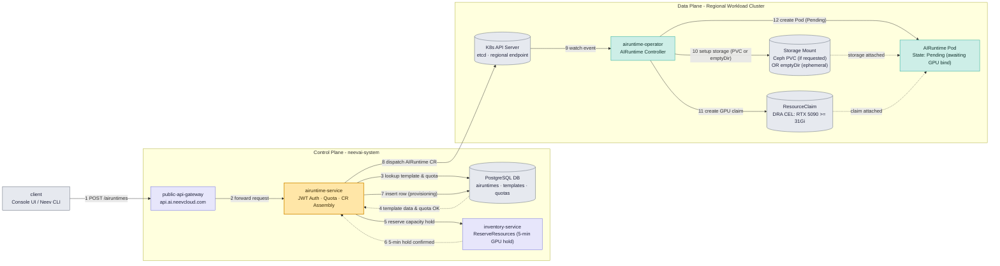

## Definition of DRA (Dynamic Resource Allocation)

**Dynamic Resource Allocation (DRA)** is a Kubernetes feature that allows applications to request GPUs by specifying their exact hardware requirements—such as GPU model name and VRAM memory size—instead of just asking for a simple number like "1 GPU".

In traditional Kubernetes setups, GPUs were treated as plain numbers (`nvidia.com/gpu: 1`), with no visibility into a card's actual model or memory size. In contrast, DRA treats every physical GPU as an individual device with its own detailed profile (model name, VRAM capacity, PCIe address, and health status).

To manage devices cleanly, DRA divides the workflow into three steps:

1. **Hardware Inventory (`ResourceSlice`):** Worker nodes publish an exact list of the physical GPUs they have in stock.
2. **Workload Requests (`ResourceClaim`):** Pods specify the exact hardware they need using search filters written in Common Expression Language (CEL).
3. **Container Attachment (CDI):** Once Kubernetes matches a pod to a GPU, it uses the Container Device Interface (CDI) to safely attach that specific card into the container.

---

## How AIRuntime Works with DRA: Step-by-Step Technical Execution

The complete lifecycle of an AIRuntime from API call to active GPU execution follows these 7 distinct steps:

### Step 1: Request Validation, Capacity Hold, and Blueprint Submission (`airuntime-service`)

1. **User Action & API Call:** The user submits a request from the UI to `POST /api/v1beta1/orgs/{org_id}/projects/{project_id}/airuntimes` specifying the runtime name, template ID, GPU hardware config ID, GPU count, region, plan ID, persistent storage size, and optional SSH keys.
2. **Template & Container Image Resolution:** `airuntime-service` queries the database for the selected template (`s.queries.GetAIRuntimeTemplate`) to resolve the container image (`template.Image`), application ports (JupyterLab on port 8888), default environment variables, and any private registry credentials.
3. **Authentication, Quotas, and Plan Verification:** Validates user JWT authentication, verifies project compute quotas, and ensures the billing `planId` matches the requested GPU hardware configuration.
4. **Admission Capacity Hold (`inventory-service`):** Calls `inventoryClient.ReserveResources` to place a temporary 5-minute capacity hold in the database (`resource_reservations` table), preventing concurrent GPU VM or model deployment requests from taking the last GPU before this runtime is provisioned.
5. **Database Record Creation:** Inserts a new row into the PostgreSQL `airuntimes` table with initial status `provisioning` and stores the reservation ID.
6. **Build Blueprint (`AIRuntime` Custom Resource):** Calls `BuildAIRuntimeCR()` to assemble the `AIRuntime` CR (`ai.neevcloud.com/v1alpha1`) containing the target namespace, GPU specifications (model, VRAM, count), resolved container image, Ceph persistent storage configuration, and a randomly generated Jupyter password annotation.
7. **Submit Blueprint to Workload Cluster (`k8sClient.Create`):** Posts the `AIRuntime` CR to the Workload Cluster API server via `k8sClient.Create(ctx, cr)`, handing off execution to the `airuntime-operator`.

---

### Step 2: Operator Creates Storage, GPU Claim, and Pod (`airuntime-operator`)

When the `airuntime-operator` sees the new `AIRuntime` CR in the Kubernetes API server, it does three things:

1. **Creates the Storage Mount (PVC):** If persistent storage is requested, it ensures a `PersistentVolumeClaim` is ready to mount at `/data/workspace` so user files are never lost.
2. **Creates the GPU Request (`ResourceClaim`):** It submits a `ResourceClaim` to Kubernetes asking for the exact GPU needed:

   ```cel
   device.attributes['gpu.nvidia.com'].productName == 'NVIDIA GeForce RTX 5090' &&
   device.capacity['gpu.nvidia.com'].memory.compareTo(quantity('31Gi')) >= 0
   ```

3. **Creates the Pod Object:** It creates the Pod in Kubernetes with container image (`pytorch-jupyter:v2.4`), storage mount (`/data/workspace`), and attaches the GPU `ResourceClaim`. *(The Pod is created in `Pending` state and does not run yet).*

---

### Step 3: Scheduler Matches the Claim to a GPU Node (`kube-scheduler`)

Once the Pod and its `ResourceClaim` are in Kubernetes, `kube-scheduler` handles the matching:

1. **Reads the Claim:** The scheduler sees the pending Pod asking for a GPU via its `ResourceClaim`.
2. **Checks Node Hardware (`ResourceSlice`):** It checks the hardware catalog (`ResourceSlice`) published by all worker nodes to find a node that has a free card matching the GPU model and VRAM.
3. **Locks the GPU:** It finds an available RTX 5090 (`gpu-0`) on `worker-3`, writes `worker-3, gpu-0` into `ResourceClaim.status.allocation`, and locks the card so no other workload can take it.
4. **Places the Pod on the Node:** It binds the Pod to `worker-3` so the node can start preparing the hardware.

---

### Step 4: Node Hardware Preparation (`kubelet` & DRA Driver DaemonSet)

Every GPU worker node in the cluster runs an **NVIDIA DRA driver DaemonSet pod** (the kubelet plugin) that directly interfaces with the node's PCIe hardware.

1. **Kubelet Receives the Pod:** The `kubelet` agent on `worker-3` sees that the Pod has been assigned to its node and recognizes that it requires a DRA resource (`gpu-claim`).
2. **Local gRPC Call (`NodePrepareResources`):** `kubelet` connects to the local **NVIDIA DRA driver DaemonSet pod** running on that same node via a local UNIX socket and executes a `NodePrepareResources` gRPC call.
3. **Hardware Reset & CDI File Generation:**
   - The NVIDIA DRA driver daemon on `worker-3` validates physical `gpu-0`, inspects its hardware address, and clears any leftover memory from prior workloads.
   - The driver then writes the **CDI (Container Device Interface) JSON file** directly to the host filesystem at `/var/run/cdi/nvidia.com-gpu.json`:

     ```json
     {
       "cdiVersion": "0.5.0",
       "kind": "nvidia.com/gpu",
       "devices": [
         {
           "name": "gpu-0",
           "containerEdits": {
             "deviceNodes": [
               {"path": "/dev/nvidia0", "hostPath": "/dev/nvidia0"},
               {"path": "/dev/nvidiactl", "hostPath": "/dev/nvidiactl"},
               {"path": "/dev/nvidia-uvm", "hostPath": "/dev/nvidia-uvm"},
               {"path": "/dev/nvidia-uvm-tools", "hostPath": "/dev/nvidia-uvm-tools"}
             ],
             "mounts": [
               {
                 "hostPath": "/usr/lib/x86_64-linux-gnu/libcuda.so.1",
                 "containerPath": "/usr/lib/x86_64-linux-gnu/libcuda.so.1",
                 "options": ["ro", "nosuid", "nodev", "bind"]
               }
             ]
           }
         }
       ]
     }
     ```

   - This JSON file is the concrete instruction sheet that tells `containerd` exactly which `/dev/` files to create and which driver libraries to attach to the container.

---

### Step 5: Container Device Attachment and Process Launch (`containerd` & CDI)

The Pod is now on `worker-3`, and the NVIDIA driver has prepared the CDI instructions file. Next, `containerd` starts the container to run the user's requested workload (e.g., PyTorch + JupyterLab).

By default, a container is isolated and cannot see or access the physical GPU on the host server. To connect the GPU to this container, `containerd` reads the CDI file (`/var/run/cdi/nvidia.com-gpu.json`) and unlocks the **operating system gates**:

1. **Gate 1: Creating the Device Files inside the Pod's `/dev/` Directory:**
   - In Linux, **every piece of hardware is represented as a file** inside the `/dev/` directory (for example, `/dev/sda` for a disk).
   - By default, a Pod's container has its own private `/dev/` folder with **zero GPU files**. If PyTorch looks for a GPU, it finds nothing and throws an error: `No CUDA GPUs are available`.
   - **Only the Requested GPU is Added (Strict Isolation):**
     - If the host node has 8 physical GPUs (`gpu-0` through `gpu-7`) and you requested **1 GPU**, the CDI file contains **ONLY** the data for that single assigned GPU (`gpu-0`).
     - It does **NOT** include any other GPUs on the node. The other 7 cards (`/dev/nvidia1` through `/dev/nvidia7`) do not exist inside your container and are completely invisible.
   - `containerd` reads the CDI file and injects only the requested card's files directly into the Pod's private `/dev/` directory:
     - **`/dev/nvidia0`**: The direct data pipeline to physical GPU 0. PyTorch writes to this file to send AI models, weights, and CUDA calculation instructions.
     - **`/dev/nvidiactl`**: The master control switch used to initialize the card, power it up, and check temperature and clock speeds.
     - **`/dev/nvidia-uvm`**: Unified Virtual Memory file that allows CPU RAM and GPU VRAM to share data directly.
     - **`/dev/nvidia-uvm-tools`**: Profiling interface used by performance monitoring tools (like PyTorch Profiler).

2. **Gate 2: Device Security Filter (Cgroups v2):**
   - Even with the files in `/dev/`, the Linux kernel blocks unauthorized hardware access by default.
   - `containerd` sets a security rule that **allows access ONLY to GPU 0** (`gpu-0`). Access to all other GPUs on the machine is strictly blocked.
   - This ensures your container can only use its assigned card and cannot touch any other user's GPU on the server.

3. **Storage Mount:**
   - If persistent storage was requested, `containerd` mounts the Ceph PVC to `/data/workspace`.

4. **Container Entrypoint Execution:**
   - With device nodes injected, security filters set, and storage mounted, `containerd` executes the container entrypoint process:

     ```bash
     jupyter lab --ip 0.0.0.0 --port 8888
     ```

   - The Pod officially transitions from `Pending` to **`Running`**.

---

### Step 6: Interactive Access Routing

1. The container entrypoint executes JupyterLab on internal port `8888`.
2. `airuntime-operator` creates an HTTP route via the Gateway API exposing `https://.../jupyter` secured by `JUPYTER_PASSWORD`.
3. If SSH access was requested, the operator configures SSHPiper to proxy SSH connections to the pod's IP using tenant SSH public keys.
4. The user connects via their browser and executes CUDA code on the bare-metal GPU.

---

### Step 7: Release on Stop (`reconcileStop`)

1. When the user stops the AIRuntime, `airuntime-controller` triggers `reconcileStop`:
   - Deletes the Deployment / Pod.
   - Deletes the `ResourceClaim`.
   - Deleting the claim releases the device lock on `gpu-0`, making it immediately free for other users in the cluster.
   - The PVC and `AIRuntime` custom resource are preserved, ensuring all files, notebooks, and checkpoints are safely kept.

---

# Architectural Placement & End-to-End Execution Flows

To ensure anyone reviewing this architecture can clearly trace **where each component lives**, **how the request enters**, and **how the DRA driver prepares and attaches the GPU into the Pod**, the system is structured into 3 clean, progressive flows following the standard RFC layout:

- **Flow 1: Request Ingestion, Admission & Blueprint Assembly** (Client → Control Plane → Operator)
- **Flow 2: DRA Scheduling, Node Preparation & Container CDI Attachment** (Scheduler → Kubelet → DRA Driver DaemonSet → CDI → containerd)
- **Flow 3: Interactive Ingress Routing & Release on Stop** (Gateway API → Running Pod → Teardown Cleanup)

---

## Flow 1: Request Ingestion, Admission & Blueprint Assembly

When a user initiates the creation of an AIRuntime instance via the Web Console or CLI, the request is ingested and verified by the **Control Plane (CP)** before being dispatched to the target **Data Plane (DP / Regional Workload Cluster)** where the physical GPUs and storage reside.

### Detailed Flow Steps

1. **Client Request:**  
   The client (Browser Console or Neev CLI) issues a `POST /api/v1beta1/orgs/{org_id}/projects/{project_id}/airuntimes` request specifying runtime name, template ID (e.g., PyTorch), GPU model SKU, GPU count, target region, pricing plan ID, and optional persistent storage size.

2. **Ingress Forwarding:**  
   The request hits **`public-api-gateway`** (`api.ai.neevcloud.com`) in the Control Plane. The gateway terminates TLS, validates the JWT Bearer token, and routes the request to **`airuntime-service`** in namespace `neevai-system`.

3. **Template & Quota Lookup:**  
   `airuntime-service` queries the central **PostgreSQL DB** (`s.queries.GetAIRuntimeTemplate`) to resolve the container image, default application ports (JupyterLab on port `8888`), and asserts that project compute quotas are sufficient.

4. **Template Data Returned:**  
   PostgreSQL returns the template configuration, image registry pull credentials, and confirms quota availability.

5. **Reserve Capacity Hold:**  
   `airuntime-service` makes an internal RPC call to **`inventory-service`** (`ReserveResources`) to acquire an atomic 5-minute capacity hold in the `resource_reservations` table. This prevents concurrent users from taking the last GPU before this instance is scheduled.

6. **Capacity Hold Confirmed:**  
   `inventory-service` returns the reservation ID confirming the GPU capacity is temporarily locked.

7. **Database Record Creation:**  
   `airuntime-service` inserts a new row into the PostgreSQL `airuntimes` table with initial state `provisioning` and stores the reservation ID.

8. **Dispatch Blueprint to Regional Workload Cluster:**  
   `airuntime-service` invokes `BuildAIRuntimeCR()` to assemble the `AIRuntime` Custom Resource (`ai.neevcloud.com/v1alpha1`). Using the regional Kubernetes client matching the target region (`s.k8sClients[airuntime.Region]`), it submits the CR to the **Data Plane K8s API Server**.

9. **Watch Event Triggered:**  
   The **`airuntime-operator`** running inside the regional Workload Cluster receives the new `AIRuntime` CR event through its controller watch loop.

10. **Storage Setup (Conditional):**
    - **If Persistent Storage was requested:** The operator creates a Ceph-backed **`PersistentVolumeClaim` (PVC)** mounted at `/data/workspace` so files persist across stop/start cycles.
    - **If Persistent Storage was NOT requested:** **No PVC is created.** The operator configures an ephemeral scratch disk (`emptyDir`).

11. **Create DRA GPU Request (`ResourceClaim`):**  
    The operator creates a Kubernetes `ResourceClaim` with the CEL hardware predicate:

    ```cel
    device.attributes['gpu.nvidia.com'].productName == 'NVIDIA GeForce RTX 5090' &&
    device.capacity['gpu.nvidia.com'].memory.compareTo(quantity('31Gi')) >= 0
    ```

12. **Create Pod (`Pending`):**  
    The operator creates the workload Pod attaching the storage (PVC or `emptyDir`) and referencing the GPU `ResourceClaim`. The Pod is placed in **`Pending`** state, ready for the Kubernetes scheduler and DRA driver to match and attach the physical GPU in Flow 2.

### Flow 1 Diagram (RFC Style)


# Flow 2: DRA Scheduling, Node Preparation & Container CDI Device Attachment

### The Big Picture (What Flow 2 Does)

At the end of Flow 1, your Pod was created in **`Pending`** state with a **`ResourceClaim`** asking for a GPU (e.g., RTX 5090 with ≥ 31GiB VRAM).

Flow 2 is the engine that:

1. **Finds** which server in the cluster has that exact free GPU.
2. **Prepares** the hardware on that server (wipes old GPU memory).
3. **Locks down & attaches** *only* that specific card into the container so other GPUs on that machine remain completely invisible.
4. **Launches** the container, moving the Pod from **`Pending` → `Running`**.

---

## Detailed Step-by-Step Breakdown

### Phase 1: Finding & Locking the GPU (`kube-scheduler`)

#### Step 1: Scheduler Detects the Pending Pod & Claim

- The Kubernetes scheduler (`kube-scheduler`) picks up the newly created Pod from the queue.
- It sees that the Pod cannot run yet because its attached **`ResourceClaim`** has not been allocated a physical GPU.

#### Step 2: Evaluates Node Hardware Catalog (`ResourceSlice`)

- Every GPU node in the cluster publishes an inventory list called a **`ResourceSlice`**. This list tells Kubernetes exactly what physical cards are installed (model name, available VRAM, PCIe addresses, and health status).
- The scheduler runs the CEL search filter from the claim against all nodes:

```cel
device.attributes['gpu.nvidia.com'].productName == 'NVIDIA GeForce RTX 5090' &&
device.capacity['gpu.nvidia.com'].memory >= 31Gi
```

#### Step 3: Locks the GPU and Binds the Pod

- The scheduler finds a matching, healthy card: **`gpu-0`** on **`worker-3`**.
- It writes `worker-3, gpu-0` into `ResourceClaim.status.allocation`. This **locks the GPU** so no other workload in the cluster can steal it.
- The scheduler binds the Pod to `worker-3`.

---

### Phase 2: Node Hardware Preparation (`kubelet` & NVIDIA Driver)

#### Step 4: Kubelet Receives the Workload

- The **`kubelet`** agent running locally on `worker-3` receives notification that a new Pod has been assigned to its machine.
- It inspects the Pod and detects that it requires a DRA device allocation (`gpu-claim`).

#### Step 5: `NodePrepareResources` gRPC Call

- To interact with physical PCIe cards, `kubelet` connects to the local **NVIDIA DRA Driver DaemonSet pod** running on that same server over a local UNIX domain socket (`/var/run/cdi/...`).
- It invokes the gRPC function: **`NodePrepareResources`**.

#### Step 6: Memory Wipe & CDI Instruction File Generation

The NVIDIA driver daemon on `worker-3` does two critical jobs:

1. **Security Memory Wipe:** It completely flushes and resets the physical VRAM and CUDA context of `gpu-0`. This guarantees that no leftover data, weights, or code from prior workloads can ever leak to the new user.
2. **Generates the CDI JSON File:** It writes the **Container Device Interface (CDI)** instruction file directly to the host disk at `/var/run/cdi/nvidia.com-gpu.json`:

```json
{
  "cdiVersion": "0.5.0",
  "kind": "nvidia.com/gpu",
  "devices": [
    {
      "name": "gpu-0",
      "containerEdits": {
        "deviceNodes": [
          {"path": "/dev/nvidia0", "hostPath": "/dev/nvidia0"},
          {"path": "/dev/nvidiactl", "hostPath": "/dev/nvidiactl"},
          {"path": "/dev/nvidia-uvm", "hostPath": "/dev/nvidia-uvm"},
          {"path": "/dev/nvidia-uvm-tools", "hostPath": "/dev/nvidia-uvm-tools"}
        ],
        "mounts": [
          {
            "hostPath": "/usr/lib/x86_64-linux-gnu/libcuda.so.1",
            "containerPath": "/usr/lib/x86_64-linux-gnu/libcuda.so.1"
          }
        ]
      }
    }
  ]
}
```

*(This JSON file is the concrete instruction sheet telling the container runtime exactly which files to give the container).*

---

### Phase 3: Container Device Attachment & Process Launch (`containerd`)

#### Step 7: Kubelet Calls Container Runtime

- `kubelet` tells **`containerd`** to create the container and passes the CDI device identifier: `nvidia.com/gpu=gpu-0`.

#### Step 8: `containerd` Reads the CDI Instructions

- `containerd` reads `/var/run/cdi/nvidia.com-gpu.json` and prepares to unlock two Linux kernel security gates.

#### Step 9: Gate 1 — Device Node Injection (Private `/dev`)

- By default, a Linux container has an empty `/dev` directory with zero GPU devices.
- `containerd` injects **ONLY** the files needed for `gpu-0`:
  - `/dev/nvidia0`: The direct data pipeline to physical GPU 0.
  - `/dev/nvidiactl`: The master control switch for hardware initialization and telemetry.
  - `/dev/nvidia-uvm`: Unified Virtual Memory (direct CPU ↔ GPU memory sharing).
  - `/dev/nvidia-uvm-tools`: Profiling interface for PyTorch/CUDA profilers.
  - `libcuda.so.1`: The host CUDA driver library (mounted read-only).
- **Strict Isolation:** If the host machine has 8 physical GPUs (`gpu-0` to `gpu-7`), the other 7 cards (`/dev/nvidia1` through `/dev/nvidia7`) are **not injected**. They simply do not exist inside your container.

#### Step 10: Gate 2 — Linux Kernel Security Filter (Cgroups v2)

- Even if a malicious user inside the container attempts to access other GPUs by guessing device numbers, the Linux kernel **Cgroups v2 device controller** strictly blocks it.
- `containerd` configures the kernel rule: Allow `read / write / mknod` **ONLY for device `gpu-0`**. Any call to other device IDs is rejected by the Linux kernel.

#### Step 11: Mount Storage & Start the Container

- `containerd` mounts the storage volume at `/data/workspace` (either the Ceph PVC if requested, or the temporary `emptyDir` scratch disk).
- It executes the container entrypoint process:

```bash
jupyter lab --ip 0.0.0.0 --port 8888
```

#### Step 12: Pod Transitions to `Running`

- The container is now healthy and active.
- Kubernetes updates the Pod status from **`Pending` → `Running`**.

---

## Flow 2 Diagram (RFC Style)

```mermaid
flowchart LR
    subgraph CP [Cluster Control Plane]
        rc[("ResourceClaim<br/>(RTX 5090 >= 31Gi)")]:::store
        rs[("ResourceSlice<br/>(Node GPU Catalog)")]:::store
        sched["kube-scheduler<br/>(DRA Plugin)"]:::cp
    end

    subgraph DP [GPU Worker Node — worker-3]
        klet["kubelet Agent"]:::dp
        dra["NVIDIA DRA Driver<br/>DaemonSet (UNIX socket)"]:::star
        cdi[("CDI JSON Spec<br/>/var/run/cdi/...")]:::store
        ctrd["containerd Runtime"]:::dp
        dev["Gate 1: Isolated /dev<br/>/dev/nvidia0, uvm, ctl"]:::dp
        cg["Gate 2: Cgroups v2<br/>Allow: gpu-0 ONLY"]:::dp
        app["AIRuntime Pod<br/>JupyterLab :8888 (Running)"]:::dp
    end

    rc --->|"1 read claim"| sched
    rs -..->|"2 evaluate CEL catalog"| sched
    sched --->|"3 lock gpu-0 & bind Pod"| klet
    klet --->|"4 NodePrepareResources"| dra
    dra --->|"5 wipe VRAM & generate spec"| cdi
    klet --->|"6 create container"| ctrd
    cdi -..->|"7 read device directives"| ctrd
    ctrd --->|"8 inject /dev/nvidia0"| dev
    ctrd --->|"9 set kernel cgroup filter"| cg
    dev ---> app
    cg ---> app

    classDef cp fill:#e7e6fb,stroke:#6b6be0,color:#20233a
    classDef dp fill:#cdeee7,stroke:#12a594,color:#10302b
    classDef star fill:#ffe6a7,stroke:#d99a1c,stroke-width:2px,color:#3a2c07
    classDef store fill:#e6e9ef,stroke:#5b6472,color:#20233a
```


