# Dynamic Resource Allocation (DRA) & AIRuntime Architecture Specification

## Definition of DRA (Dynamic Resource Allocation)

**Dynamic Resource Allocation (DRA)** is a Kubernetes feature that allows applications to request GPUs by specifying their exact hardware requirements—such as GPU model name and VRAM memory size—instead of just asking for a simple number like `"1 GPU"`.

In traditional Kubernetes GPU allocation, GPUs were requested using a simple resource count, such as `nvidia.com/gpu: 1`. Kubernetes knew how many GPUs were requested but did not provide detailed device-level information through this resource request, such as the GPU model, VRAM capacity, or PCIe address.

With Dynamic Resource Allocation (DRA), each physical GPU is represented as an individual device. This allows Kubernetes to identify and manage GPUs separately, along with their device information, such as GPU model, VRAM capacity, PCIe address, and health status.

---

## How AIRuntime Works with DRA: Step-by-Step Technical Execution

The complete lifecycle of an AIRuntime from API call to active GPU execution follows these 7 distinct steps:

### Step 1: From User API Request to Kubernetes CR Creation (`airuntime-service`)

This step covers everything that happens from the moment a user clicks **"Create"** in the UI until the workload blueprint (the `AIRuntime` Custom Resource) is created and handed over to Kubernetes:

1. **User Action & API Submission:**  
   The user chooses their GPU (e.g., RTX 5090), software template (e.g., PyTorch), region, and storage in the UI, then clicks **Create**. The UI sends an HTTP request:  
   `POST /api/v1beta1/orgs/{org_id}/projects/{project_id}/airuntimes`

2. **Gateway Forwarding (TLS Termination & Routing):**  
   The request hits **`public-api-gateway`** (Istio Ingress Gateway at `api.ai.neevcloud.com`).  
   - The gateway decrypts HTTPS (TLS termination).  
   - It does **not** authenticate the user. It acts as an L7 reverse proxy, forwarding the raw HTTP request and `Authorization: Bearer <token>` header directly to `airuntime-service`.

3. **Authentication & Authorization (`airuntime-service`):**  
   Inside `airuntime-service`, built-in middleware processes the request:  
   - **JWT Validation:** Validates the signature of the Bearer token and extracts `user_id`.  
   - **OPA Permission Check:** Queries Open Policy Agent (OPA) to confirm the user has permission to create GPU workloads in this project.

4. **Template Specification & Workload Resolution:**  
   `airuntime-service` queries the `airuntime_templates` database table using the requested `template_id` to determine:  
   - **Container Image:** The exact Docker image to pull and execute on the GPU (e.g., `pytorch-jupyter:v2.4`).  
   - **Application & Port Configuration:** The interactive applications to expose and their network ports (e.g., JupyterLab on port `8888` with an auto-generated secure login password).

5. **GPU Hardware Validation (`inventoryClient.GetGpuConfig`):**  
   `airuntime-service` calls `inventory-service` using `gpu_config_id` to confirm physical hardware specs:  
   - GPU Model: `NVIDIA GeForce RTX 5090`  
   - VRAM: `32 GiB`  
   - CPU & System RAM allocations.

6. **Atomic 5-Minute Capacity Hold (`inventoryClient.ReserveResources`):**  
   Before creating anything in Kubernetes, `airuntime-service` calls `inventory-service` to place a temporary **5-minute lock** on 1 physical GPU in that region.  
   - *Why:* To immediately secure the hardware so concurrent users cannot take the last GPU.

7. **Wallet Balance & Billing Verification (`billingClient.ValidateFunds`):**  
   Calls `billing-service` to ensure:  
   - The selected billing plan matches the GPU model.  
   - The user/organization has sufficient wallet balance (at least 1 hour of credits for on-demand usage). *(If this fails, the capacity hold is immediately released).*

8. **Storage Setup & Validation:**  
   Checks the user's storage choice:  
   - If reusing an existing volume, verifies it is in `bound` state in that region.  
   - If requesting a new volume, calls `storage-service` to provision a Ceph network volume to be mounted at `/data/workspace`.

9. **Database Record Creation (`s.queries.CreateAIRuntime`):**  
   Inserts a new row into the PostgreSQL `airuntimes` table with initial status **`pending`**, and generates a secure 16-character login password for JupyterLab.

10. **Build and Post Custom Resource:**  
    `airuntime-service` builds the custom resource and posts it to the regional Kubernetes API server.

---

### Step 2: Operator Creates the GPU Claim and Workload Pod (`airuntime-operator`)

`airuntime-operator` runs in GPU worker nodes. To prevent conflicts, it runs under Kubernetes **Leader Election** (`1a4350ec.ai.neevcloud.com`), ensuring only one active leader pod processes requests at a time while standby copies wait for automatic failover.

Inside the operator pod, two components handle the work:
* **`airuntime-controller` (The Watcher):** Watches the Kubernetes API server for new or updated `AIRuntime` custom resources.
* **`AIRuntimeReconciler` (The Worker):** Takes the request and executes the actual work step-by-step.

---

#### Step-by-Step Execution:

1. **Catches the Request (`airuntime-controller`):**  
   The controller sees the new `AIRuntime` Custom Resource (CR) in the API server and puts it into the work queue.

2. **Loads and Validates the CR (`AIRuntimeReconciler`):**  
   The reconciler reads the CR into memory via `r.Get()` and confirms the GPU model, configuration ID, and Docker container image are valid.

3. **Sets Status to `Deploying`:**  
   Updates the runtime phase to `Deploying` (`Status.Phase = "Deploying"`) so users and backend services know provisioning has started.

4. **Checks Storage (Ceph PVC):**  
   Verifies that the Ceph storage volume (PVC) exists in the project namespace. If the volume is not ready yet, it pauses and retries in 5 seconds.

5. **Creates the GPU Claim (`ResourceClaim`):**  
   The reconciler builds a DRA `ResourceClaim` specifying the required GPU model and VRAM using a CEL rule, sets the `AIRuntime` CR as its owner, and posts it to the Kubernetes API server:

   ```cel
   device.attributes['gpu.nvidia.com'].productName == 'NVIDIA GeForce RTX 5090' &&
   device.capacity['gpu.nvidia.com'].memory.compareTo(quantity('31Gi')) >= 0
   ```

6. **Creates the Pod Spec and Adds the ResourceClaim:**  
   The reconciler builds the Pod specification and attaches the GPU `ResourceClaim` to it:
   - Sets the container image (e.g., PyTorch + JupyterLab).
   - Mounts the Ceph storage volume at `/data/workspace`.
   - Adds the GPU `ResourceClaim` under `pod.spec.resourceClaims`.
   - Injects the JupyterLab login password.
   - Leaves `nodeName` empty (`""`) so the scheduler can pick the physical node.
   - Sends the Pod specification to the Kubernetes API server.

---

### Step 3: Scheduler Matches the Workload to a GPU Node (`kube-scheduler`)

1. **GPU Catalogs on the Master Node (`ResourceSlice`):**  
   Every GPU worker node registers its physical cards with the **Master Node** (API Server). The Master Node stores these `ResourceSlice` catalogs listing all available GPUs across the cluster.

2. **Scheduler Checks the Master Node Catalog:**  
   Running on the Master Node, **`kube-scheduler`** inspects the `ResourceSlice` records to find a worker node with a free RTX 5090.

3. **Locks the GPU and Binds to the Worker Node:**  
   The scheduler locks the chosen GPU (e.g., `gpu-0` on `worker-3`) and assigns the workload to that worker node (`pod.spec.nodeName = "worker-3"`).

4. **Handoff to the Worker Node:**  
   The Master Node dispatches the assignment to `worker-3`, and that worker node takes over to prepare the hardware and launch the GPU Pod (Step 4).

```mermaid
flowchart LR

    %% -------------------------------------------------------------
    %% 1. CLIENT TIER
    %% -------------------------------------------------------------
    subgraph CLIENT_TIER ["Client Tier (External)"]
        cl["client<br/>(Console UI / Neev CLI)"]:::store
    end

    %% -------------------------------------------------------------
    %% 2. MANAGEMENT CLUSTER
    %% -------------------------------------------------------------
    subgraph MGMT ["MANAGEMENT CLUSTER (Central Control Plane)"]
        gw["public-api-gateway"]:::cp
        asvc["airuntime-service"]:::star
        inv["inventory-service"]:::cp
        bill["billing-service"]:::cp
        db[("PostgreSQL DB")]:::store
    end

    %% -------------------------------------------------------------
    %% 3. RECONCILER (System Worker Node)
    %% -------------------------------------------------------------
    subgraph OPERATOR ["AIRUNTIME OPERATOR (Workload Cluster - System Worker Node)"]
        actrl["airuntime-controller<br/>(Watches Events)"]:::dp
        arec["AIRuntimeReconciler<br/>(Worker)"]:::dp
        prep_claim["1. Prepare GPU ResourceClaim<br/>(RTX 5090 CEL Request)"]:::star
        prep_pod["2. Prepare Pod Spec<br/>(References ResourceClaim and PVC)"]:::star
    end

    %% -------------------------------------------------------------
    %% 4. WORKLOAD CLUSTER MASTER NODES
    %% -------------------------------------------------------------
    subgraph WKLD_MASTER ["WORKLOAD CLUSTER - Master Nodes (API Server, etcd, Scheduler)"]
        cr_airuntime[("AIRuntime CR")]:::k8s
        pvc[("PVC Metadata")]:::k8s
        rc[("ResourceClaim Object<br/>(Status: Waiting for Scheduling)")]:::k8s
        pod_obj[("Pod Spec Object<br/>(Status: Pending | nodeName: '')")]:::k8s
        rs[("ResourceSlice<br/>(GPU Inventory)")]:::k8s
        sched["kube-scheduler<br/>(DRA Scheduling Plugin)"]:::star
    end

    %% -------------------------------------------------------------
    %% 5. GPU WORKER NODE
    %% -------------------------------------------------------------
    subgraph WKLD_GPU ["WORKLOAD CLUSTER - GPU Worker Node (worker-3)"]
        running_pod["AIRuntime Pod<br/>(Running Container)"]:::gpu
        gpu_hw["Physical GPU<br/>(RTX 5090 / gpu-0)"]:::store
        csi_driver["Ceph CSI Driver"]:::dp
    end

    %% -------------------------------------------------------------
    %% 6. CEPH STORAGE CLUSTER
    %% -------------------------------------------------------------
    subgraph CEPH_TIER ["REGIONAL STORAGE NETWORK"]
        ceph_cluster[("Ceph Storage Cluster<br/>(Actual Files & Weights)")]:::ceph
    end

    %% =============================================================
    %% FLOW ARROWS (With concise & wrapped labels to stay on lines)
    %% =============================================================

    %% API Gateway & Control Plane
    cl --->|"1 POST /airuntimes"| gw
    gw --->|"2 forward"| asvc
    asvc --->|"3 lookup"| db
    asvc --->|"4 hold GPU"| inv
    asvc --->|"5 check credits"| bill
    asvc --->|"6 insert pending"| db

    %% Post CR
    asvc ====>|"7 post CR<br/>(cross-cluster)"| cr_airuntime

    %% Controller Triggers Reconciler
    cr_airuntime --->|"8 watch"| actrl
    actrl --->|"9 trigger"| arec
    arec --->|"10 set Deploying"| cr_airuntime
    arec --->|"11 check PVC"| pvc

    %% PREPARE & POST RESOURCECLAIM
    arec --->|"12 prepare claim"| prep_claim
    prep_claim ====>|"13 post ResourceClaim"| rc

    %% PREPARE & POST POD SPEC
    prep_claim --->|"14 prepare pod"| prep_pod
    rc -..->|"claim name"| prep_pod
    pvc -..->|"volume mount"| prep_pod
    prep_pod ====>|"15 post Pod spec"| pod_obj

    %% SCHEDULER EVALUATION
    pod_obj --->|"16 detect Pending"| sched
    rc -..->|"claim rules"| sched
    rs -..->|"match GPU"| sched
    sched ====>|"17 bind gpu-0<br/>set worker-3"| pod_obj

    %% EXECUTION ON GPU NODE
    pod_obj ====>|"18 launch Pod"| running_pod
    gpu_hw -..->|"attach GPU"| running_pod
    csi_driver --->|"19 mount storage"| running_pod
    csi_driver ----|"network storage"| ceph_cluster

    %% =============================================================
    %% STYLING
    %% =============================================================
    classDef cp fill:#e7e6fb,stroke:#6b6be0,color:#20233a
    classDef dp fill:#cdeee7,stroke:#12a594,color:#10302b
    classDef star fill:#ffe6a7,stroke:#d99a1c,stroke-width:2px,color:#3a2c07
    classDef store fill:#e6e9ef,stroke:#5b6472,color:#20233a
    classDef k8s fill:#e6e9ef,stroke:#3b82f6,stroke-width:2px,color:#1e3a8a
    classDef gpu fill:#d1fae5,stroke:#059669,stroke-width:2px,color:#064e3b
    classDef ceph fill:#fef3c7,stroke:#b45309,stroke-width:2px,color:#78350f
```




---

### Step 4: Node Hardware Preparation (`kubelet` & DRA Driver DaemonSet)

Every GPU worker node in the cluster runs an **NVIDIA DRA driver DaemonSet pod** (the kubelet plugin) that directly interfaces with the node's PCIe hardware.

1. **Kubelet Receives the Pod:** The `kubelet` agent on `worker-3` sees that the Pod has been assigned to its node and recognizes that it requires a DRA resource (`gpu-claim`).
2. **Local gRPC Call (`NodePrepareResources`):** `kubelet` connects to the local **NVIDIA DRA driver DaemonSet pod** running on that same node via a local UNIX socket and executes a `NodePrepareResources` gRPC call.
3. **Hardware Reset & CDI File Generation:**
   - The NVIDIA DRA driver daemon on `worker-3` validates physical `gpu-0`, inspects its hardware address, and clears any leftover memory from prior workloads.
   - The driver then writes the **CDI (Container Device Interface) JSON file** directly to the host filesystem at `/var/run/cdi/nvidia.com-gpu.json`:

     ```json
     {
       "cdiVersion": "0.5.0",
       "kind": "nvidia.com/gpu",
       "devices": [
         {
           "name": "gpu-0",
           "containerEdits": {
             "deviceNodes": [
               {"path": "/dev/nvidia0", "hostPath": "/dev/nvidia0"},
               {"path": "/dev/nvidiactl", "hostPath": "/dev/nvidiactl"},
               {"path": "/dev/nvidia-uvm", "hostPath": "/dev/nvidia-uvm"},
               {"path": "/dev/nvidia-uvm-tools", "hostPath": "/dev/nvidia-uvm-tools"}
             ],
             "mounts": [
               {
                 "hostPath": "/usr/lib/x86_64-linux-gnu/libcuda.so.1",
                 "containerPath": "/usr/lib/x86_64-linux-gnu/libcuda.so.1",
                 "options": ["ro", "nosuid", "nodev", "bind"]
               }
             ]
           }
         }
       ]
     }
     ```

   - This JSON file is the concrete instruction sheet that tells `containerd` exactly which `/dev/` files to create and which driver libraries to attach to the container.

---

### Step 5: Container Device Attachment and Process Launch (`containerd` & CDI)

The Pod is now on `worker-3`, and the NVIDIA driver has prepared the CDI instructions file. Next, `containerd` starts the container to run the user's requested workload (e.g., PyTorch + JupyterLab).

By default, a container is isolated and cannot see or access the physical GPU on the host server. To connect the GPU to this container, `containerd` reads the CDI file (`/var/run/cdi/nvidia.com-gpu.json`) and unlocks the **operating system gates**:

1. **Gate 1: Creating the Device Files inside the Pod's `/dev/` Directory:**
   - In Linux, **every piece of hardware is represented as a file** inside the `/dev/` directory (for example, `/dev/sda` for a disk).
   - By default, a Pod's container has its own private `/dev/` folder with **zero GPU files**. If PyTorch looks for a GPU, it finds nothing and throws an error: `No CUDA GPUs are available`.
   - **Only the Requested GPU is Added (Strict Isolation):**
     - If the host node has 8 physical GPUs (`gpu-0` through `gpu-7`) and you requested **1 GPU**, the CDI file contains **ONLY** the data for that single assigned GPU (`gpu-0`).
     - It does **NOT** include any other GPUs on the node. The other 7 cards (`/dev/nvidia1` through `/dev/nvidia7`) do not exist inside your container and are completely invisible.
   - `containerd` reads the CDI file and injects only the requested card's files directly into the Pod's private `/dev/` directory:
     - **`/dev/nvidia0`**: The direct data pipeline to physical GPU 0. PyTorch writes to this file to send AI models, weights, and CUDA calculation instructions.
     - **`/dev/nvidiactl`**: The master control switch used to initialize the card, power it up, and check temperature and clock speeds.
     - **`/dev/nvidia-uvm`**: Unified Virtual Memory file that allows CPU RAM and GPU VRAM to share data directly.
     - **`/dev/nvidia-uvm-tools`**: Profiling interface used by performance monitoring tools (like PyTorch Profiler).

2. **Gate 2: Device Security Filter (Cgroups v2):**
   - Even with the files in `/dev/`, the Linux kernel blocks unauthorized hardware access by default.
   - `containerd` sets a security rule that **allows access ONLY to GPU 0** (`gpu-0`). Access to all other GPUs on the machine is strictly blocked.
   - This ensures your container can only use its assigned card and cannot touch any other user's GPU on the server.

3. **Storage Mount:**
   - If persistent storage was requested, `containerd` mounts the Ceph PVC to `/data/workspace`.

4. **Container Entrypoint Execution:**
   - With device nodes injected, security filters set, and storage mounted, `containerd` executes the container entrypoint process:

     ```bash
     jupyter lab --ip 0.0.0.0 --port 8888
     ```

   - The Pod officially transitions from `Pending` to **`Running`**.

```mermaid
flowchart LR
    pod["AIRuntime Pod<br/>Operator Created<br/>State: Pending"]:::star

    subgraph CP["Cluster Control Plane (Master Node)"]
        direction TB
        rc[("ResourceClaim<br/>RTX 5090 >= 31Gi")]:::store
        rs[("ResourceSlice<br/>Node GPU Catalog")]:::store
        sched["kube-scheduler<br/>DRA Plugin<br/>CEL Evaluation"]:::cp
    end

    subgraph DP["GPU Worker Node - worker-3"]
        direction TB

        klet["kubelet Agent<br/>Node Supervisor"]:::dp

        dra["NVIDIA DRA Driver<br/>DaemonSet<br/>UNIX Domain Socket"]:::star

        cdi[("CDI JSON Specification<br/>/var/run/cdi/<br/>nvidia.com-gpu.json")]:::store

        ctrd["containerd<br/>CRI Runtime"]:::dp

        subgraph ISO["GPU Security and Isolation"]
            direction TB
            dev["Gate 1: Device Node Injection<br/>/dev/nvidia0<br/>/dev/nvidiactl<br/>/dev/nvidia-uvm<br/>/dev/nvidia-uvm-tools<br/>libcuda.so.1"]:::security

            cg["Gate 2: Cgroups v2<br/>eBPF Device Filtering<br/>Allow gpu-0 ONLY"]:::security
        end

        storage[("Storage Mount<br/>/data/workspace<br/>Ceph PVC")]:::store

        app["AIRuntime Pod<br/>JupyterLab :8888<br/>State: Running"]:::success
    end

    pod -->|"1. Pod created with GPU Claim"| rc
    rc -->|"2. Scheduler reads claim"| sched
    rs -.->|"3. Match GPU Inventory<br/>RTX 5090 >= 31Gi"| sched
    sched -->|"4. Allocate gpu-0<br/>on worker-3 and bind Pod"| klet
    klet -->|"5. NodePrepareResources<br/>gRPC call"| dra
    dra -.->|"6. Validate GPU, clear VRAM<br/>Generate CDI JSON"| cdi
    klet -->|"7. Create Container"| ctrd
    cdi -.->|"8. Read CDI Instructions"| ctrd
    ctrd -->|"9. Inject allocated GPU devices"| dev
    ctrd -->|"10. Configure device access filter"| cg
    ctrd -->|"11. Mount persistent storage"| storage
    dev -->|"12. GPU device ready"| app
    cg -->|"13. Security enforced"| app
    storage -->|"14. Workspace mounted"| app

    classDef cp fill:#e7e6fb,stroke:#6b6be0,color:#20233a
    classDef dp fill:#cdeee7,stroke:#12a594,color:#10302b
    classDef star fill:#ffe6a7,stroke:#d99a1c,stroke-width:2px,color:#3a2c07
    classDef store fill:#e6e9ef,stroke:#5b6472,color:#20233a
    classDef security fill:#fce4d6,stroke:#d97736,color:#542b12
    classDef success fill:#d5f5df,stroke:#239653,stroke-width:2px,color:#123d25
```



---

### Step 6: Release on Stop (`reconcileStop`)

1. When the user stops the AIRuntime, the **`AIRuntimeReconciler`** triggers `reconcileStop`:
   - Deletes the Deployment / Pod.
   - Deletes the `ResourceClaim`.
   - Deleting the claim releases the device lock on `gpu-0`, making it immediately free for other users in the cluster.
   - The PVC and `AIRuntime` custom resource are preserved, ensuring all files, notebooks, and checkpoints are safely kept.

